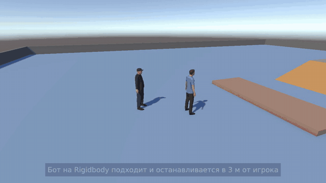

# Persecutor — преследование на Unity

🎬 Полное видео (33 с): [Video/Persecutor_demo.mp4](Video/Persecutor_demo.mp4)

Учебный проект на Unity 6 (6000.3.23f1, URP).

- **Игрок** двигается на `CharacterController`.
- **Бот** двигается на `Rigidbody`. Он преследует игрока, не подходит вплотную и всегда медленнее.
- На уровне есть небольшая ступенька, подъём и спуск. Игрок и бот проходят их одинаково, а ещё оба умеют прыгать.
- Модели — из пака Floreswa. Своих анимаций в нём нет, поэтому ходьба и прыжок сделаны процедурно.

## Как запустить

1. Открыть папку проекта в Unity Hub (Unity 6000.3.23f1).
2. Открыть сцену `Assets/Scenes/PersecutorDemo.unity` и нажать **Play**.

Пересобрать сцену можно через меню **Tools ▸ Persecutor ▸ Собрать демо-сцену**.

## Управление

| Клавиша | Действие |
|---|---|
| WASD | ходьба относительно камеры |
| Space | прыжок |
| Мышь | поворот камеры |
| Esc / клик в окне игры | отпустить / захватить курсор |

## Что где

| Файл | Что делает |
|---|---|
| `Assets/Persecutor/Scripts/PlayerMovement.cs` | игрок: `CharacterController`, ходьба, прыжок, гравитация |
| `Assets/Persecutor/Scripts/BotChaser.cs` | бот: `Rigidbody`, преследование, дистанция, ступеньки, склоны, прыжок |
| `Assets/Persecutor/Scripts/CharacterAnimator.cs` | процедурная анимация: стойка, ходьба, прыжок |
| `Assets/Persecutor/Scripts/ThirdPersonCamera.cs` | камера от третьего лица |
| `Assets/Persecutor/Editor/PersecutorSceneBuilder.cs` | собирает демо-сцену из примитивов Unity |
| `Assets/Scenes/PersecutorDemo.unity` | демо-сцена |

## Как это работает

**Игрок.** `CharacterController.Move()` сам поднимает персонажа на ступеньку не выше `stepOffset` (0,45 м) и не пускает на склоны круче `slopeLimit` (45°). Пока игрок стоит на земле, его прижимает вниз, поэтому на спусках он не подпрыгивает.

**Бот.**

- Скорость — 70 % от скорости игрока: 3,5 м/с против 5 м/с.
- Останавливается в 3 м от игрока и снова идёт, когда тот отходит дальше 4 м.
- Идёт по следу игрока (точка каждые 0,5 м), поэтому проходит там же, где прошёл игрок.
- `stepOffset`, `slopeLimit`, высоту прыжка и гравитацию берёт у игрока, поэтому препятствия они проходят одинаково.
- **Ступеньки.** Низ капсулы поднят на высоту ступеньки, поэтому низкие препятствия её не задевают. Луч вниз находит землю и держит ноги на её уровне — на ступеньке, подъёме и спуске.
- **Прыжок.** Бот прыгает, если впереди стенка выше ступеньки, но ниже высоты прыжка.

## Уровень

| Препятствие | Размер |
|---|---|
| Ступенька | 0,3 м |
| Подъём | 20°, ведёт на платформу высотой 1,6 м |
| Спуск | 30° |
| Барьер | 0,9 м — только перепрыгнуть |

## Ассеты

Модели персонажей — Low Poly Character Pack от Floreswa из Unity Asset Store (папка `Assets/Floreswa`).
